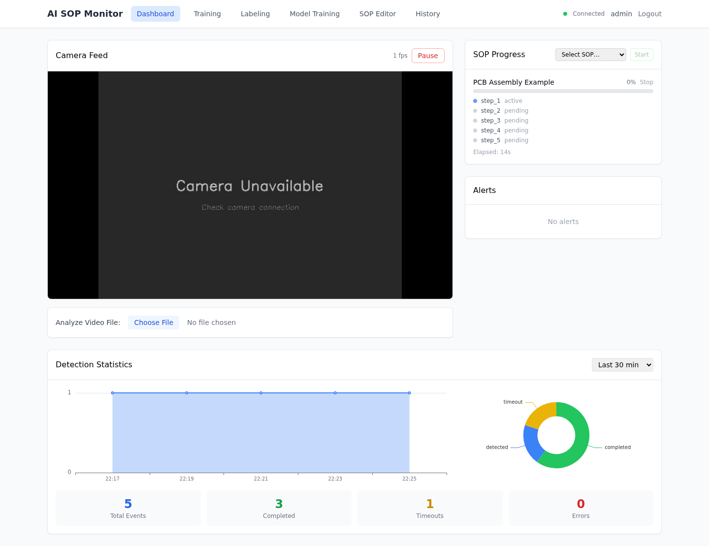
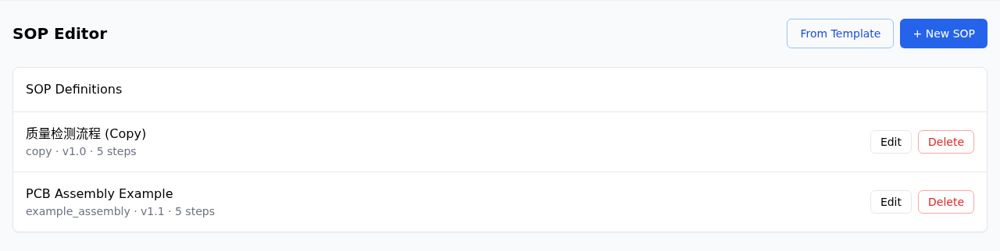
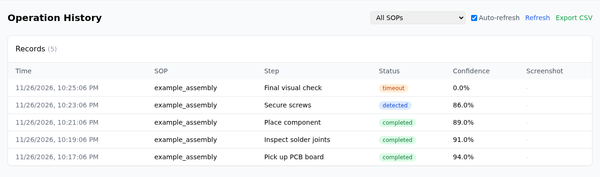

<div align="center">

# AI SOP Monitor

**Turn camera feeds into real-time SOP compliance signals.**

YOLO26 · PyTorch · FastAPI · Vue 3 · WebSocket · Docker

[中文文档](README_zh.md) | [English Documentation](README.md)

[](https://www.python.org/)
[](https://fastapi.tiangolo.com/)
[](https://vuejs.org/)
[](https://www.docker.com/)
[](LICENSE)

[](https://github.com/MacTian/AI-SOP/stargazers)
[](https://github.com/MacTian/AI-SOP/forks)

[Quick Start](#quick-start) · [Features](#features) · [Screenshots](#screenshots) · [API](#api-endpoints) · [Contributing](#contributing)

</div>

AI SOP Monitor is an open-source, end-to-end reference application for real-time SOP compliance monitoring. It combines YOLO26 object detection, configurable rules, a timeout-aware state machine, multi-level alerts, audit history, and a live Vue dashboard. It ships with mock mode and Docker support so you can explore the full workflow without specialized hardware.

> **Building an assembly, inspection, training, or industrial vision workflow?** Fork it, replace the demo SOP, and adapt the rules to your process.

## Why Developers Star and Fork It

- **A complete vertical slice, not another model demo** — camera capture, inference, event rules, SOP state, alerts, screenshots, SQLite records, REST API, WebSocket, and UI are already connected.
- **Try it without a camera or GPU** — mock detection mode and Docker Compose support let you start the full application without specialized hardware.
- **Fork-friendly extension points** — replace models, add SOP YAML rules, connect more cameras, or integrate your own alerting and storage.
- **A practical computer vision reference** — FastAPI + Vue 3 + PyTorch + OpenCV in one deployable project.

## Who Is It For

- Manufacturing, quality, and operations teams prototyping SOP compliance checks
- Computer vision and industrial automation engineers building a new workflow
- AI, robotics, and software engineering learners who want a complete CV application to study and extend

If that sounds useful, a star helps more builders discover the project, and a fork gives you a clean starting point for your own SOP rules.

## Screenshots

### Monitoring Dashboard



### SOP Editor



### Operation History



## Features

### Core Capabilities
- **Real-time Video Stream** — MJPEG camera feed with YOLO detection overlays
- **SOP State Machine** — Automatically tracks SOP step progress with timeout detection
- **Hit Frame Confirmation** — Requires N consecutive frames of target detection to confirm step completion, preventing single-frame false triggers
- **Rule Engine** — Configurable detection rules (object types, confidence thresholds, quantity requirements)
- **Alert System** — Multi-level alerts (info/warning/error/critical) with escalation mechanism and audio notifications

### AI Recognition
- **YOLO26 Object Detection** — Default real-time detector for 80 object classes, with legacy YOLOv8 model support and mock mode for testing
- **MediaPipe Hand Landmarks** — Extracts 21 hand landmarks × 2 hands (126-dimensional feature vector)
- **LSTM Temporal Classifier** — Temporal action recognition based on YOLO + hand features
- **Multi-scale Window Voting** — Prediction fusion across multiple window lengths (16/32/48 frames) to reduce recognition jitter
- **Top-3 Candidate Display** — Dashboard shows top 3 most likely steps with confidence scores in real-time

### YOLO Data Annotation & Model Training
- **Data Annotation** — Supports both **bounding box** and **polygon** annotation modes with mouse-based drawing, canvas zoom/pan, and undo functionality
- **Polygon Annotation** — Click to place vertices, double-click/right-click to close polygon, with vertex snapping for precise irregular target annotation
- **Model Training** — Upload ZIP datasets (supports bbox + polygon mixed format), configure training parameters, monitor training progress and metrics (loss/mAP) in real-time
- **Data Export** — Supports YOLO format (bbox + segmentation) and COCO JSON format
- **Domestic Mirror Acceleration** — YOLO training pre-trained weights are fetched from a domestic mirror (ghfast.top) when available
- **Model Management** — One-click model download or set as current detection model after training
- **YOLO Auto-annotation** — Generates annotation suggestions based on current detector

### Data Management
- **Automatic Screenshot Archiving** — Saves annotated frame screenshots when steps are completed
- **Operation Records** — SQLite storage of all detection events with filtering and query support
- **CSV Export** — One-click export of operation records to CSV
- **Data Visualization** — ECharts charts: detection timeline, status distribution, completion rate statistics

### SOP Management
- **SOP Template Library** — 4 pre-built templates (electronic assembly, quality inspection, packaging, equipment operation)
- **SOP Editor** — Frontend visual SOP creation and editing
- **Training Function** — Record → Auto-analyze steps → Manual optimization → Save as SOP
- **Video File Analysis** — Upload video files for offline SOP compliance analysis

### Real-time Communication
- **WebSocket Push** — Frontend auto-refreshes progress, alerts, and candidate steps
- **Global Toast Notifications** — Alert pop-ups with Web Audio sound notifications

## System Requirements

| Component | Requirement |
|-----------|------------|
| Python | 3.10+ |
| Node.js | 18+ |
| Camera | USB camera (/dev/video0), or use mock mode |
| Operating System | Windows 10/11 + WSL2 or Ubuntu 22.04 |
| GPU | Optional (automatically uses GPU inference if CUDA available) |

## Quick Start

### 1. Install Dependencies

```bash
# Python dependencies
pip install fastapi uvicorn opencv-python numpy pydantic pydantic-settings \
    aiofiles python-multipart pyyaml sqlalchemy ultralytics mediapipe torch

# Node.js dependencies (install nvm first)
source ~/.nvm/nvm.sh && nvm use 18
cd frontend && npm install
```

### 2. Start Services

```bash
# Method 1: SPA mode (recommended, starts everything with one command)
./scripts/run_spa.sh
# → Frontend build → static/ → Backend unified service
# → Open browser: http://localhost:8000

# Method 2: Development mode (frontend hot reload + backend)
./scripts/run_dev.sh
# → Backend: http://localhost:8000 + Frontend: http://localhost:5173

# Method 3: Docker deployment
docker compose up --build
# → http://localhost:8000
# → The detector downloads yolo26n.pt on first startup and falls back to mock mode if unavailable
```

### 3. Access System

**SPA Mode (recommended):**

| URL | Description |
|-----|-------------|
| http://localhost:8000 | Full application (frontend + API + WebSocket) |
| http://localhost:8000/docs | Swagger API documentation |
| http://localhost:8000/video/stream | MJPEG video stream |

**Development Mode:**

| URL | Description |
|-----|-------------|
| http://localhost:5173 | Frontend dev server (hot reload) |
| http://localhost:8000 | Backend API |

## Project Structure

```
sop-monitor/
├── backend/
│   ├── main.py                     # FastAPI entry point, lifecycle management
│   ├── config.py                   # Pydantic Settings configuration
│   ├── camera/
│   │   ├── capture.py              # OpenCV camera capture thread
│   │   ├── multi_camera.py         # Multi-camera manager
│   │   └── preprocessor.py         # Image preprocessing (resize, ROI, JPEG)
│   ├── inference/
│   │   ├── detector.py             # YOLO26 detector (YOLOv8 compatible, with mock fallback)
│   │   ├── engine.py               # Inference engine (capture→preprocess→detect→annotate)
│   │   ├── hand_extractor.py       # MediaPipe hand landmark extraction
│   │   ├── feature_fusion.py       # YOLO + hand feature fusion
│   │   ├── lstm_classifier.py      # LSTM classifier + multi-scale voting
│   │   ├── lstm_trainer.py         # LSTM model trainer
│   │   ├── mock_data.py            # Synthetic training data generator
│   │   └── models/
│   │       └── hand_landmarker.task # MediaPipe hand detection model
│   ├── extractor/
│   │   ├── event.py                # SopEvent data class
│   │   └── rule_engine.py          # Detection→SOP step event mapping
│   ├── sop/
│   │   ├── schema.py               # SOP Pydantic models (with confirm_frames)
│   │   ├── state_machine.py        # SOP state machine (hit-frame confirmation)
│   │   └── sop_manager.py          # SOP YAML file CRUD
│   ├── alert/
│   │   └── manager.py              # Alert management (deduplication, escalation, rules)
│   ├── training/
│   │   ├── session.py              # Training recording session
│   │   └── analyzer.py             # Step auto-recognition algorithm
│   ├── api/
│   │   ├── auth.py                 # JWT auth (login + user info)
│   │   ├── ws.py                   # WebSocket real-time push
│   │   ├── sop.py                  # SOP REST API + templates
│   │   ├── monitor.py              # Monitor data + records query + CSV export + candidates
│   │   ├── video.py                # MJPEG stream + snapshots + multi-camera
│   │   ├── video_analysis.py       # Video file upload analysis
│   │   ├── alert_config.py         # Alert rule CRUD
│   │   ├── stats.py                # Statistics API (ECharts data source)
│   │   ├── training.py             # Training API (recording + LSTM training)
│   │   ├── labeling.py             # YOLO data annotation API (auto-labeling)
│   │   └── yolo_training.py        # YOLO model training API (dataset + training + model management)
│   └── models/
│       ├── database.py             # SQLite init + auto-migration + admin seed
│       ├── record.py               # OperationRecord ORM (with screenshot_path)
│       └── user.py                 # User ORM (username, hashed_password, role)
├── frontend/src/
│   ├── views/
│   │   ├── Dashboard.vue           # Main monitor (video + progress + alerts + Top3 + video analysis)
│   │   ├── SopEditor.vue           # SOP creation/editing/deletion
│   │   ├── History.vue             # Operation records (screenshot viewing + CSV export)
│   │   ├── Training.vue            # Training page (recording + LSTM training)
│   │   ├── Labeling.vue            # YOLO data annotation (image upload + canvas drawing + auto-labeling)
│   │   ├── ModelTraining.vue       # YOLO model training (dataset upload + training monitoring + model download)
│   │   └── Login.vue               # Authentication page
│   ├── components/
│   │   ├── VideoStream.vue         # Video stream component
│   │   ├── SopProgress.vue         # SOP progress + hit-frame progress
│   │   ├── AlertPanel.vue          # Alert panel
│   │   ├── AlertToast.vue          # Global toast + web audio
│   │   ├── StatsChart.vue          # ECharts statistics chart
│   │   ├── StepEditor.vue          # Drag-and-drop step editor
│   │   └── TemplateSelector.vue    # Template selection popup
│   ├── api/http.js                 # Axios instance + JWT interceptor
│   ├── composables/useWebSocket.js # Auto-reconnect WebSocket
│   └── stores/
│       ├── monitor.js              # Pinia monitor state
│       └── auth.js                 # Pinia auth state
├── sop_definitions/
│   ├── example_assembly.yaml       # Example SOP
│   └── templates/                  # 4 pre-built templates
├── tests/                          # 161 test cases
├── scripts/                        # Startup scripts
├── Dockerfile                      # Multi-stage build (frontend + backend)
├── docker-compose.yml              # Docker Compose service definition
└── requirements.txt                # Python dependency list
```

## SOP Definition File

SOP uses YAML format, stored in `sop_definitions/` directory:

```yaml
sop_id: example_assembly
name: "PCB Assembly Example"
steps:
  - step_id: step_1
    name: "Pick up PCB board"
    order: 0
    timeout: 60
    rule:
      expected_objects: ["board", "hand"]
      min_confidence: 0.6
      required_count: 1
      confirm_frames: 3    # Consecutive frames required for confirmation
```

## API Endpoints

### Authentication
| Method | Path | Description |
|--------|------|-------------|
| POST | `/api/auth/login` | Login (form-data: username, password) |
| GET | `/api/auth/me` | Get current user info |

### SOP Management
| Method | Path | Description |
|--------|------|-------------|
| GET | `/api/sop/list` | List all SOPs |
| GET | `/api/sop/{sop_id}` | Get SOP details |
| POST | `/api/sop/` | Create/update SOP |
| DELETE | `/api/sop/{sop_id}` | Delete SOP |
| GET | `/api/sop/templates/list` | List templates |
| POST | `/api/sop/templates/{id}/use` | Create SOP from template |

### Monitor Data
| Method | Path | Description |
|--------|------|-------------|
| GET | `/api/monitor/status` | Current active SOP statuses |
| POST | `/api/monitor/start/{sop_id}` | Start monitoring a SOP instance |
| POST | `/api/monitor/stop/{sop_id}` | Stop a running SOP instance |
| GET | `/api/monitor/sop/{sop_id}/state` | Get one SOP instance state |
| GET | `/api/monitor/detection/candidates` | Top-3 candidate steps |
| GET | `/api/monitor/records` | Operation records query |
| GET | `/api/monitor/records/export` | CSV export |
| GET | `/api/monitor/alerts` | Recent alerts list |
| POST | `/api/monitor/alerts/{alert_id}/acknowledge` | Acknowledge an alert |

### Video
| Method | Path | Description |
|--------|------|-------------|
| GET | `/video/stream` | MJPEG video stream |
| GET | `/video/snapshot` | Single JPEG snapshot |
| GET | `/screenshots/{filename}` | Get screenshot file (Bearer token required) |
| GET | `/video/cameras` | List active cameras |
| GET | `/video/stream/{camera_id}` | Specific camera MJPEG stream |
| POST | `/api/video/analyze` | Upload video file for analysis |

Live `/video/*` endpoints are public so browser `` tags can render the stream. Screenshot files are authenticated.

### Training
| Method | Path | Description |
|--------|------|-------------|
| POST | `/api/training/start` | Start training recording |
| POST | `/api/training/stop` | Stop recording + analyze |
| GET | `/api/training/status` | Current training status |
| GET | `/api/training/result` | Latest analysis result |
| POST | `/api/training/reset` | Reset the training session |
| POST | `/api/training/save` | Save as SOP |
| POST | `/api/training/lstm/train` | Train LSTM model |
| GET | `/api/training/lstm/status` | LSTM training status |

### YOLO Data Annotation
| Method | Path | Description |
|--------|------|-------------|
| POST | `/api/label/auto` | Single image YOLO auto-labeling (returns bbox suggestions) |
| POST | `/api/label/batch` | Batch image YOLO auto-labeling |

**Annotation Types:**
- **Bounding Box (box)** — Drag to draw, YOLO format: `class cx cy w h`
- **Polygon (polygon)** — Click to place vertices, close with double-click/right-click, YOLO segmentation format: `class x1 y1 x2 y2 ...`

### YOLO Model Training
| Method | Path | Description |
|--------|------|-------------|
| POST | `/api/training/yolo/dataset/upload` | Upload dataset ZIP |
| POST | `/api/training/yolo/start` | Start YOLO training |
| POST | `/api/training/yolo/stop` | Stop training |
| GET | `/api/training/yolo/status` | Training status and metrics |
| GET | `/api/training/yolo/gpu-info` | GPU availability information |
| GET | `/api/training/yolo/download` | Download trained model |
| POST | `/api/training/yolo/use` | Set as current detection model |

### Statistics & Alerts
| Method | Path | Description |
|--------|------|-------------|
| GET | `/api/stats/summary` | Overall statistics summary |
| GET | `/api/stats/timeline` | Timeline data |
| GET | `/api/stats/detections` | Detection statistics |
| GET | `/api/stats/sop/{sop_id}/completion` | SOP completion statistics |
| GET | `/api/alerts/rules` | Alert rules |
| POST | `/api/alerts/rules` | Create alert rule |
| DELETE | `/api/alerts/rules/{sop_id}/{step_id}` | Delete alert rule |
| POST | `/api/alerts/acknowledge-all` | Acknowledge all alerts |

## Configuration

Configure via environment variables or `.env` file (prefix `SOP_`):

| Variable | Default | Description |
|----------|---------|-------------|
| `SOP_CAMERA_DEVICE` | 0 | Camera device index |
| `SOP_CAMERA_DEVICES` | "" | Multi-camera device IDs (comma-separated, e.g., "0,1,2") |
| `SOP_CAMERA_FPS` | 15 | Capture frame rate |
| `SOP_MODEL_PATH` | models/yolo26n.pt | YOLO model path |
| `SOP_CONFIDENCE_THRESHOLD` | 0.5 | Detection confidence threshold |
| `SOP_INFERENCE_INTERVAL` | 0.5 | Inference interval (seconds) |
| `SOP_DEFAULT_CONFIRM_FRAMES` | 3 | Default hit-frame confirmation count |
| `SOP_STRICT_ORDER` | false | Strict order mode (disallow step skipping) |
| `SOP_ALERT_COOLDOWN` | 30 | Alert deduplication cooldown (seconds) |
| `SOP_SECRET_KEY` | Auto-generated if unset | JWT signing key (set a stable random value in production) |
| `SOP_TOKEN_EXPIRE_MINUTES` | 480 | Token expiration (minutes) |
| `SOP_DEFAULT_ADMIN_PASSWORD` | admin123 | Default admin password |

## Testing

```bash
python3 -m pytest -q
```

161 tests cover SOP schema, state machine (hit-frame confirmation, strict order, timeout transitions), rule engine, concurrency-safe alert management, detector, SOP management, training, LSTM classification, multi-camera, JWT auth, WebSocket transport, security regressions, and API endpoints.

## Default Account

Admin account auto-created on first launch:

| Username | Password | Role |
|----------|----------|------|
| admin | admin123 | admin |

**Production note:** Before exposing the service, override `SOP_DEFAULT_ADMIN_PASSWORD` and set `SOP_SECRET_KEY` to a stable random value. Docker Compose intentionally leaves `SOP_SECRET_KEY` unset, so the backend generates a per-process key unless you provide one.

## Data Flow

```
Camera(s) → CameraCapture (thread) → ImagePreprocessor → YOLO26 Detector
                                                          ↓
                                                   MediaPipe HandExtractor
                                                          ↓
                                                   FeatureFusion (YOLO + hand)
                                                          ↓
                                                   LSTM MultiScaleVoter (optional)
                                                          ↓
                                                   RuleEngine.evaluate()
                                                          ↓
                                                   StateMachineEngine.process_event()
                                                          ↓
                                        ┌─────────────────┼─────────────────┐
                                   AlertManager      DB Record (SQLite)    WebSocket → Frontend
                                        ↓
                                   Screenshot saved
```

## Backend Architecture

### Modules

- **camera/** — Camera capture (OpenCV thread), multi-camera manager, preprocessing
- **inference/** — YOLO26 detection (YOLOv8 compatible), MediaPipe hand extraction, feature fusion, LSTM classifier, mock data generation
- **extractor/** — Detection→SOP event mapping via rule engine
- **sop/** — SOP YAML CRUD, state machine with hit-frame confirmation
- **alert/** — Alert deduplication, escalation, rule-based management
- **training/** — Training recording sessions, step auto-recognition
- **api/** — REST API routes (auth, SOP, monitor, video, training, YOLO labeling)
- **models/** — SQLite database, ORM models (User, OperationRecord)

## Frontend Architecture

- **Vue 3 Composition API** with **Pinia** state management
- **Vite** build tool with **TailwindCSS** styling
- **ECharts** for data visualization
- **WebSocket** for real-time updates with auto-reconnect
- **Web Audio API** for alert sound notifications

## Key Design Patterns

1. **Mock Degradation** — YOLO detector, hand extractor, and gesture classifier have graceful mock fallback for development without GPU or camera
2. **Category Mapping Layer** — SOP semantic names (board, tool, solder) → configurable COCO detectable class mapping
3. **Hit-Frame Confirmation** — Requires `confirm_frames` (default 3) consecutive detections to advance steps, preventing false triggers
4. **Strict Order Mode** — Optional `strict_order` configuration to reject non-current step events
5. **Multi-Camera Support** — Each camera runs independent capture+inference pipeline with unified callback
6. **Feature Fusion** — YOLO features (80 classes × count+confidence = 160-dim) + MediaPipe hand landmarks (126-dim) = 286-dim fusion vector
7. **Dual Delivery** — FastAPI serves both REST API and built Vue SPA (catch-all route)

## Contributing

Issues, feature requests, SOP examples, deployment notes, and pull requests are welcome.

- **Star this repository** if it gives you a useful starting point: [Star AI SOP Monitor](https://github.com/MacTian/AI-SOP/stargazers)
- **Fork it** to adapt the workflow to your own process: [Fork on GitHub](https://github.com/MacTian/AI-SOP/forks)
- **Share an issue** for bugs, model support, or integration ideas: [Open an issue](https://github.com/MacTian/AI-SOP/issues)

## License

This project is licensed under the [MIT License](LICENSE).

---

**Documentation:** [中文版](README_zh.md) | [English Version](README.md)

If this project saves you time, a star helps more builders find it.
