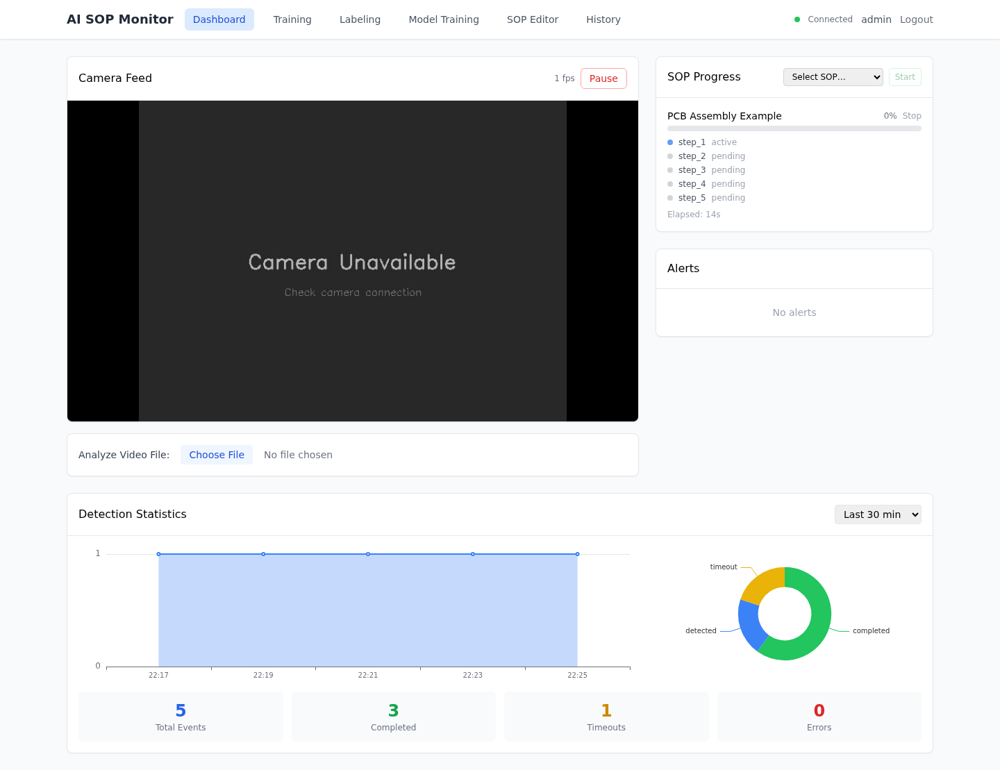
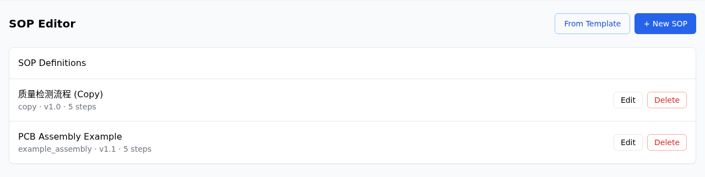
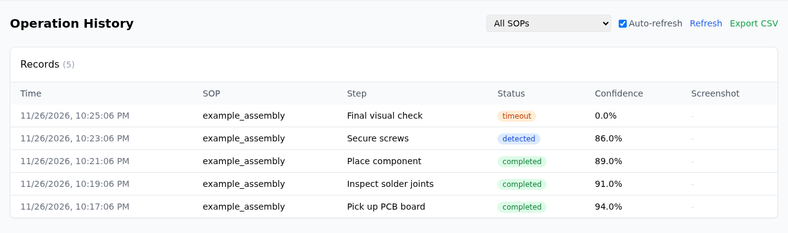

<div align="center">

# AI SOP Monitor

**把摄像头画面变成实时的 SOP 合规信号。**

YOLO26 · PyTorch · FastAPI · Vue 3 · WebSocket · Docker

[中文文档](README_zh.md) | [English Documentation](README.md)

[](https://www.python.org/)
[](https://fastapi.tiangolo.com/)
[](https://vuejs.org/)
[](https://www.docker.com/)
[](LICENSE)

[](https://github.com/MacTian/AI-SOP/stargazers)
[](https://github.com/MacTian/AI-SOP/forks)

[快速开始](#快速开始) · [功能特性](#功能特性) · [界面截图](#界面截图) · [API 接口](#api-接口) · [参与贡献](#参与贡献)

</div>

AI SOP Monitor 是一个开源、端到端的实时 SOP 合规监控参考项目。它将 YOLO26 目标检测、可配置规则、带超时处理的状态机、多级告警、审计历史和 Vue 实时看板连接成一条完整链路，并提供 mock 模式和 Docker 支持，让你无需专用硬件也能快速体验完整流程。

> **正在搭建装配、质检、培训或工业视觉流程？** Fork 这个项目，替换示例 SOP，再把规则改造成你的业务流程。

## 为什么值得 Star 和 Fork

- **完整业务闭环，不只是一个模型 Demo** — 摄像头采集、推理、规则、SOP 状态、告警、截图、SQLite 记录、REST API、WebSocket 和前端界面已经打通。
- **没有摄像头或 GPU 也能体验** — mock 检测模式和 Docker Compose 支持让你无需专用硬件即可启动完整应用。
- **适合二次开发** — 可替换模型、增加 SOP YAML 规则、接入更多摄像头，或对接自己的告警和存储系统。
- **一份可落地的计算机视觉参考** — FastAPI + Vue 3 + PyTorch + OpenCV 集中在同一个可部署项目里。

## 适合谁

- 正在验证 SOP 合规检查的制造、质量和运营团队
- 构建新工作流的计算机视觉、工业自动化工程师
- 希望研究并扩展完整视觉应用的 AI、机器人和软件工程学习者

如果这个项目对你有帮助，Star 可以让更多开发者发现它，Fork 则能给你一个清晰的二次开发起点。

## 界面截图

### 实时监控 Dashboard



### SOP 编辑器



### 操作历史



## 功能特性

### 核心能力
- **实时视频流** — MJPEG 摄像头画面，叠加 YOLO 检测框
- **SOP 状态机** — 自动跟踪 SOP 步骤进度，支持超时检测
- **命中帧确认** — 连续 N 帧检测到目标才确认步骤完成，防止单帧误触发
- **规则引擎** — 可配置的检测规则（目标类型、置信度、数量要求）
- **告警系统** — 多级告警（info/warning/error/critical），支持升级机制和声音提示

### AI 识别
- **YOLO26 目标检测** — 默认实时检测 80 类物体，兼容旧版 YOLOv8 模型，并支持 mock 模式
- **MediaPipe 手部关键点** — 提取 21 个手部关键点 × 2 只手（126 维特征）
- **LSTM 时序分类器** — 基于 YOLO + 手部特征的时序动作识别
- **多尺度窗口投票** — 多窗口长度预测融合（16/32/48 帧），降低识别抖动
- **Top3 候选展示** — Dashboard 实时显示最可能的 3 个步骤及置信度

### YOLO 数据标注与模型训练
- **数据标注** — 支持**矩形框**和**多边形**两种标注模式，鼠标框选绘制，画布缩放/平移，Undo 撤销
- **多边形标注** — 点击放置顶点，双击/右键闭合多边形，支持顶点吸附，精确标注不规则目标
- **模型训练** — 上传 ZIP 数据集（支持 bbox + polygon 混合格式），配置训练参数，实时监控训练进度和指标（loss/mAP）
- **数据导出** — 支持 YOLO 格式（bbox + segmentation）和 COCO JSON 格式导出
- **国内镜像加速** — YOLO 训练预训练权重可用时优先从国内镜像（ghfast.top）下载
- **模型管理** — 训练完成后一键下载模型或设为当前检测模型
- **YOLO 自动标注** — 基于当前检测器自动识别目标，生成标注建议

### 数据管理
- **自动截图归档** — 步骤完成时自动保存标注帧截图
- **操作记录** — SQLite 存储所有检测事件，支持筛选查询
- **CSV 导出** — 一键导出操作记录为 CSV 文件
- **数据可视化** — ECharts 图表：检测时序、状态分布、完成率统计

### SOP 管理
- **SOP 模板库** — 4 个预置模板（电子组装、质量检测、包装、设备操作）
- **SOP 编辑器** — 前端可视化创建/编辑 SOP
- **训练功能** — 录像 → 自动分析步骤 → 手动优化 → 保存为 SOP
- **视频文件分析** — 上传视频文件离线分析 SOP 合规性

### 实时通信
- **WebSocket 推送** — 前端自动刷新进度、告警、候选步骤
- **全局 Toast 通知** — 告警弹窗 + Web Audio 声音提示

## 系统要求

| 组件 | 要求 |
|------|------|
| Python | 3.10+ |
| Node.js | 18+ |
| 摄像头 | USB 摄像头（/dev/video0），或使用 mock 模式 |
| 操作系统 | Windows 10/11 + WSL2 或 Ubuntu 22.04 |
| GPU | 可选（有 CUDA 则自动使用 GPU 推理） |

## 快速开始

### 1. 安装依赖

```bash
# Python 依赖
pip install fastapi uvicorn opencv-python numpy pydantic pydantic-settings \
    aiofiles python-multipart pyyaml sqlalchemy ultralytics mediapipe torch

# Node.js 依赖（需先安装 nvm）
source ~/.nvm/nvm.sh && nvm use 18
cd frontend && npm install
```

### 2. 启动服务

```bash
# 方式一：SPA 模式（推荐，一条命令启动全部）
./scripts/run_spa.sh
# → 前端 build → static/ → 后端统一服务
# → 浏览器打开 http://localhost:8000

# 方式二：开发模式（前端热重载 + 后端）
./scripts/run_dev.sh
# → 后端 http://localhost:8000 + 前端 http://localhost:5173

# 方式三：Docker 部署
docker compose up --build
# → http://localhost:8000
# → 首次启动会下载 yolo26n.pt，下载不可用时自动降级为 mock 模式
```

### 3. 访问系统

SPA 模式（推荐）：

| 地址 | 说明 |
|------|------|
| http://localhost:8000 | 完整应用（前端 + API + WebSocket） |
| http://localhost:8000/docs | Swagger API 文档 |
| http://localhost:8000/video/stream | MJPEG 视频流 |

开发模式：

| 地址 | 说明 |
|------|------|
| http://localhost:5173 | 前端开发服务器（热重载） |
| http://localhost:8000 | 后端 API |

## 项目结构

```
sop-monitor/
├── backend/
│   ├── main.py                     # FastAPI 入口，生命周期管理
│   ├── config.py                   # Pydantic Settings 配置
│   ├── camera/
│   │   ├── capture.py              # OpenCV 摄像头采集线程
│   │   ├── multi_camera.py         # 多摄像头管理器
│   │   └── preprocessor.py         # 图像预处理（resize, ROI, JPEG）
│   ├── inference/
│   │   ├── detector.py             # YOLO26 检测器（兼容 YOLOv8，支持 mock fallback）
│   │   ├── engine.py               # 推理引擎（采集→预处理→检测→标注）
│   │   ├── hand_extractor.py       # MediaPipe 手部关键点提取
│   │   ├── feature_fusion.py       # YOLO + 手部特征融合
│   │   ├── lstm_classifier.py      # LSTM 分类器 + 多尺度投票
│   │   ├── lstm_trainer.py         # LSTM 模型训练器
│   │   ├── mock_data.py            # 合成训练数据生成
│   │   └── models/
│   │       └── hand_landmarker.task # MediaPipe 手部检测模型
│   ├── extractor/
│   │   ├── event.py                # SopEvent 数据类
│   │   └── rule_engine.py          # 检测结果→SOP 步骤事件映射
│   ├── sop/
│   │   ├── schema.py               # SOP Pydantic 模型（含 confirm_frames）
│   │   ├── state_machine.py        # SOP 状态机（命中帧确认 + 严格顺序）
│   │   └── sop_manager.py          # SOP YAML 文件 CRUD
│   ├── alert/
│   │   └── manager.py              # 告警管理（去重、升级、规则配置）
│   ├── training/
│   │   ├── session.py              # 训练录像会话
│   │   └── analyzer.py             # 步骤自动识别算法
│   ├── api/
│   │   ├── auth.py                 # JWT 认证（登录 + 用户信息）
│   │   ├── ws.py                   # WebSocket 实时推送
│   │   ├── sop.py                  # SOP REST API + 模板
│   │   ├── monitor.py              # 监控数据 + 记录查询 + CSV 导出 + 候选
│   │   ├── video.py                # MJPEG 视频流 + 截图服务 + 多摄像头
│   │   ├── video_analysis.py       # 视频文件上传分析
│   │   ├── alert_config.py         # 告警规则 CRUD
│   │   ├── stats.py                # 统计数据 API（ECharts 数据源）
│   │   ├── training.py             # 训练 API（录像 + LSTM 训练）
│   │   ├── labeling.py             # YOLO 数据标注 API（自动标注）
│   │   └── yolo_training.py        # YOLO 模型训练 API（数据集 + 训练 + 模型管理）
│   └── models/
│       ├── database.py             # SQLite 初始化 + 自动迁移 + 种子管理员
│       ├── record.py               # OperationRecord ORM（含 screenshot_path）
│       └── user.py                 # User ORM（username, hashed_password, role）
├── frontend/src/
│   ├── views/
│   │   ├── Dashboard.vue           # 主监控（视频 + 进度 + 告警 + Top3 + 视频分析）
│   │   ├── SopEditor.vue           # SOP 编辑页
│   │   ├── History.vue             # 历史记录（截图查看 + CSV 导出）
│   │   ├── Training.vue            # 训练页（录像 + LSTM 训练）
│   │   ├── Labeling.vue            # YOLO 数据标注（图片上传 + 画布标注 + 自动标注）
│   │   ├── ModelTraining.vue       # YOLO 模型训练（数据集上传 + 训练监控 + 模型下载）
│   │   └── Login.vue               # 登录页面
│   ├── components/
│   │   ├── VideoStream.vue         # 视频流组件
│   │   ├── SopProgress.vue         # SOP 进度 + 命中帧进度
│   │   ├── AlertPanel.vue          # 告警面板
│   │   ├── AlertToast.vue          # 全局 toast + 声音
│   │   ├── StatsChart.vue          # ECharts 统计图表
│   │   ├── StepEditor.vue          # 拖拽步骤编辑器
│   │   └── TemplateSelector.vue    # 模板选择弹窗
│   ├── api/http.js                 # Axios 实例 + JWT 拦截器
│   ├── composables/useWebSocket.js # 自动重连 WebSocket
│   └── stores/
│       ├── monitor.js              # Pinia 监控状态
│       └── auth.js                 # Pinia 认证状态
├── sop_definitions/
│   ├── example_assembly.yaml       # 示例 SOP
│   └── templates/                  # 4 个预置模板
├── tests/                          # 161 个测试用例
├── scripts/                        # 启动脚本
├── Dockerfile                      # 多阶段构建（前端 + 后端）
├── docker-compose.yml              # Docker Compose 服务定义
└── requirements.txt                # Python 依赖清单
```

## SOP 定义文件

SOP 使用 YAML 格式定义，存放在 `sop_definitions/` 目录下：

```yaml
sop_id: example_assembly
name: "PCB Assembly Example"
steps:
  - step_id: step_1
    name: "拿起 PCB 板"
    order: 0
    timeout: 60
    rule:
      expected_objects: ["board", "hand"]
      min_confidence: 0.6
      required_count: 1
      confirm_frames: 3    # 连续 3 帧确认才完成
```

## API 接口

### 认证
| 方法 | 路径 | 说明 |
|------|------|------|
| POST | `/api/auth/login` | 登录（form-data: username, password） |
| GET | `/api/auth/me` | 获取当前用户信息 |

### SOP 管理
| 方法 | 路径 | 说明 |
|------|------|------|
| GET | `/api/sop/list` | 列出所有 SOP |
| GET | `/api/sop/{sop_id}` | 获取 SOP 详情 |
| POST | `/api/sop/` | 创建/更新 SOP |
| DELETE | `/api/sop/{sop_id}` | 删除 SOP |
| GET | `/api/sop/templates/list` | 列出模板 |
| POST | `/api/sop/templates/{id}/use` | 从模板创建 SOP |

### 监控数据
| 方法 | 路径 | 说明 |
|------|------|------|
| GET | `/api/monitor/status` | 当前所有活跃 SOP 状态 |
| POST | `/api/monitor/start/{sop_id}` | 启动一个 SOP 监控实例 |
| POST | `/api/monitor/stop/{sop_id}` | 停止正在运行的 SOP 实例 |
| GET | `/api/monitor/sop/{sop_id}/state` | 获取单个 SOP 实例状态 |
| GET | `/api/monitor/detection/candidates` | Top3 候选步骤 |
| GET | `/api/monitor/records` | 操作记录查询 |
| GET | `/api/monitor/records/export` | CSV 导出 |
| GET | `/api/monitor/alerts` | 最近告警列表 |
| POST | `/api/monitor/alerts/{alert_id}/acknowledge` | 确认单条告警 |

### 视频
| 方法 | 路径 | 说明 |
|------|------|------|
| GET | `/video/stream` | MJPEG 视频流 |
| GET | `/video/snapshot` | 单帧 JPEG 截图 |
| GET | `/screenshots/{filename}` | 获取截图（需要 Bearer Token） |
| GET | `/video/cameras` | 列出活跃摄像头 |
| GET | `/video/stream/{camera_id}` | 指定摄像头 MJPEG 流 |
| POST | `/api/video/analyze` | 上传视频文件分析 |

`/video/*` 实时端点保持公开，以便浏览器 `` 直接渲染视频流；截图文件需要认证。

### 训练
| 方法 | 路径 | 说明 |
|------|------|------|
| POST | `/api/training/start` | 开始训练录像 |
| POST | `/api/training/stop` | 停止录像 + 分析 |
| GET | `/api/training/status` | 当前训练状态 |
| GET | `/api/training/result` | 最近一次分析结果 |
| POST | `/api/training/reset` | 重置训练会话 |
| POST | `/api/training/save` | 保存为 SOP |
| POST | `/api/training/lstm/train` | 训练 LSTM 模型 |
| GET | `/api/training/lstm/status` | LSTM 训练状态 |

### YOLO 数据标注
| 方法 | 路径 | 说明 |
|------|------|------|
| POST | `/api/label/auto` | 单张图片 YOLO 自动标注（返回 bbox 建议） |
| POST | `/api/label/batch` | 批量图片 YOLO 自动标注 |

支持标注类型：
- **矩形框 (box)** — 拖拽绘制，YOLO 格式：`class cx cy w h`
- **多边形 (polygon)** — 点击顶点闭合，YOLO 分割格式：`class x1 y1 x2 y2 ...`

### YOLO 模型训练
| 方法 | 路径 | 说明 |
|------|------|------|
| POST | `/api/training/yolo/dataset/upload` | 上传数据集 ZIP |
| POST | `/api/training/yolo/start` | 开始 YOLO 训练 |
| POST | `/api/training/yolo/stop` | 停止训练 |
| GET | `/api/training/yolo/status` | 训练状态与指标 |
| GET | `/api/training/yolo/gpu-info` | GPU 可用性信息 |
| GET | `/api/training/yolo/download` | 下载训练好的模型 |
| POST | `/api/training/yolo/use` | 设为当前检测模型 |

### 统计 & 告警
| 方法 | 路径 | 说明 |
|------|------|------|
| GET | `/api/stats/summary` | 总体统计摘要 |
| GET | `/api/stats/timeline` | 时序数据 |
| GET | `/api/stats/detections` | 检测统计 |
| GET | `/api/stats/sop/{sop_id}/completion` | SOP 完成率统计 |
| GET | `/api/alerts/rules` | 告警规则 |
| POST | `/api/alerts/rules` | 创建告警规则 |
| DELETE | `/api/alerts/rules/{sop_id}/{step_id}` | 删除告警规则 |
| POST | `/api/alerts/acknowledge-all` | 确认全部告警 |

## 配置项

通过环境变量或 `.env` 文件配置（前缀 `SOP_`）：

| 变量 | 默认值 | 说明 |
|------|--------|------|
| `SOP_CAMERA_DEVICE` | 0 | 摄像头设备号 |
| `SOP_CAMERA_DEVICES` | "" | 多摄像头设备号（逗号分隔，如 "0,1,2"） |
| `SOP_CAMERA_FPS` | 15 | 采集帧率 |
| `SOP_MODEL_PATH` | models/yolo26n.pt | YOLO 模型路径 |
| `SOP_CONFIDENCE_THRESHOLD` | 0.5 | 检测置信度阈值 |
| `SOP_INFERENCE_INTERVAL` | 0.5 | 推理间隔（秒） |
| `SOP_DEFAULT_CONFIRM_FRAMES` | 3 | 默认命中帧确认数 |
| `SOP_STRICT_ORDER` | false | 严格顺序模式（禁止跳步） |
| `SOP_ALERT_COOLDOWN` | 30 | 告警去重冷却（秒） |
| `SOP_SECRET_KEY` | 未设置时自动生成 | JWT 签名密钥（生产环境请设置稳定的随机值） |
| `SOP_TOKEN_EXPIRE_MINUTES` | 480 | Token 有效期（分钟） |
| `SOP_DEFAULT_ADMIN_PASSWORD` | admin123 | 默认管理员密码 |

## 测试

```bash
python3 -m pytest -q
```

161 个测试覆盖：SOP schema、状态机（命中帧确认、严格顺序、超时流转）、规则引擎、并发安全的告警管理、检测器、SOP 管理、训练功能、LSTM 分类器、多摄像头、JWT 认证、WebSocket 传输、安全回归和 API 端点。

## 默认账户

首次启动自动创建管理员账户：

| 用户名 | 密码 | 角色 |
|--------|------|------|
| admin | admin123 | admin |

生产环境暴露服务前，请覆盖 `SOP_DEFAULT_ADMIN_PASSWORD`，并将 `SOP_SECRET_KEY` 设置为稳定的随机值。Docker Compose 有意不设置 `SOP_SECRET_KEY`，未提供时后端会为当前进程生成临时密钥。

## 运行流程

```
摄像头 → 采集线程 → 预处理 → YOLO26 检测 → 规则引擎 → 状态机（命中帧确认）→ 告警管理
                                    ↓                                           ↓
                              MediaPipe 手部                               自动截图归档
                                    ↓                                           ↓
                            特征融合 → LSTM 分类                             数据库记录
                                    ↓                                           ↓
                            Top3 候选计算                                  WebSocket 广播
                                    ↓                                           ↓
                              Dashboard 显示                              ECharts 图表
```

## 后端架构

### 模块

- **camera/** — OpenCV 摄像头采集线程、多摄像头管理、图像预处理
- **inference/** — YOLO26 检测（兼容 YOLOv8）、MediaPipe 手部关键点、特征融合、LSTM 分类器、模拟数据生成
- **extractor/** — 通过规则引擎完成检测结果到 SOP 事件的映射
- **sop/** — SOP YAML CRUD、带命中帧确认的状态机
- **alert/** — 告警去重、升级和规则管理
- **training/** — 训练录像会话、步骤自动识别
- **api/** — REST API 路由（认证、SOP、监控、视频、训练、YOLO 标注）
- **models/** — SQLite 数据库和 ORM 模型（User、OperationRecord）

## 前端架构

- 使用 **Vue 3 Composition API** 和 **Pinia** 管理状态
- 使用 **Vite** 构建、**TailwindCSS** 样式
- 使用 **ECharts** 展示数据可视化
- 使用 **WebSocket** 接收实时更新并自动重连
- 使用 **Web Audio API** 播放告警声音

## 关键设计模式

1. **Mock 降级** — YOLO 检测器、手部提取器和手势分类器在无 GPU、无摄像头或依赖不可用时提供降级路径
2. **类别映射层** — 将 SOP 语义名称（board、tool、solder）映射到可配置的 COCO 检测类别
3. **命中帧确认** — 要求连续 `confirm_frames` 次检测（默认 3）才推进步骤，降低误触发
4. **严格顺序模式** — 可通过 `strict_order` 配置拒绝非当前步骤事件
5. **多摄像头支持** — 每个摄像头运行独立采集与推理流水线，通过统一回调汇总
6. **特征融合** — YOLO 特征（80 类 × 数量和置信度 = 160 维）与 MediaPipe 手部关键点（126 维）组成 286 维融合向量
7. **双形态交付** — FastAPI 同时提供 REST API 和构建后的 Vue SPA（catch-all 路由）

## 参与贡献

欢迎提交 Issues、功能建议、SOP 示例、部署经验和 Pull Request。

- **给项目点一个 Star**，让更多开发者发现它：[Star AI SOP Monitor](https://github.com/MacTian/AI-SOP/stargazers)
- **Fork 到自己的仓库**，改造成你的业务流程：[Fork on GitHub](https://github.com/MacTian/AI-SOP/forks)
- **提交问题或想法**，帮助项目继续完善：[Open an issue](https://github.com/MacTian/AI-SOP/issues)

## 许可证

本项目使用 [MIT License](LICENSE)。

---

**文档：** [中文版](README_zh.md) | [English Version](README.md)

如果这个项目帮你节省了时间，欢迎点一个 Star，让更多开发者看到它。

